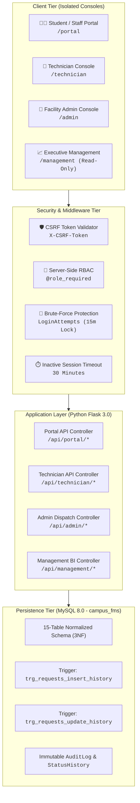

<div align="center">

# 🏛️ Campus Facility Maintenance Request Management System (Campus FMS)

**An enterprise-grade, full-stack facility operations, technician dispatch, and maintenance management platform engineered for academic institutions and enterprise campuses.**

[](https://python.org)
[](https://flask.palletsprojects.com/)
[](https://www.mysql.com/)
[](https://developer.mozilla.org/en-US/docs/Web/JavaScript)
[](#-automated-testing--security-verification)
[](LICENSE)

<br />

<p align="center">
  <a href="#-key-highlights">Key Highlights</a> •
  <a href="#-system-architecture">System Architecture</a> •
  <a href="#-role-based-consoles">Consoles & Workflows</a> •
  <a href="#-database-schema--design">Database Design</a> •
  <a href="#-security--access-control">Security Controls</a> •
  <a href="#-quickstart-guide">Quickstart Guide</a> •
  <a href="#-demo-credentials">Demo Credentials</a>
</p>

</div>

---

## 📌 Executive Summary

Managing facility maintenance across sprawling university campuses often suffers from fragmented incident logging, untracked work orders, broken accountability chains, and zero visibility into material expenditures and SLA adherence.

**Campus FMS** solves this with a centralized, high-performance web platform featuring:
- **Four Dedicated Role Consoles** with isolated URLs and strict server-side authorization.
- **Automated Technician Dispatch** with skill-based filtering and availability tracking.
- **Forward-Only Lifecycle State Machine** backed by database triggers to guarantee audit compliance.
- **Precise Material & Cost Tracking** localized in Indian Rupees (**₹**).
- **Executive BI Dashboards** delivering live SLA compliance metrics and expenditure analytics without external heavy frameworks.

---

## ✨ Key Highlights

- ⚡ **Lightweight & Blazing Fast:** Built with clean Python Flask backend and modern Vanilla HTML5/CSS3/ES6+ JavaScript without cumbersome node build steps or client-side bloat.
- 🔒 **Defense-in-Depth Security:** Server-side RBAC (`@role_required`), cryptographic CSRF tokens, database-backed brute force protection (5-attempt 15-minute lock), IDOR prevention, and HTTP security headers.
- 🗄️ **Strict 15-Table 3NF MySQL Database:** Normalized relational architecture featuring Foreign Keys with cascade rules, custom indexes, automated status logging triggers, and least-privilege database user isolation.
- ⏱️ **Real-Time SLA & Escalation Engine:** Built-in priority matrix (`Urgent` 12h, `High` 24h, `Medium` 48h, `Low` 72h) with dynamic countdowns and deadline alerts.
- ⭐ **Closed-Loop Feedback:** Requesters review resolutions and rate technician service with 1–5 star ratings and qualitative remarks before a ticket is archived as `Closed`.
- 📊 **Executive Analytics:** High-level executive dashboard featuring interactive Chart.js visualizations, financial breakdowns, and tamper-evident audit logs.

---

## 🏗️ System Architecture



---

## 🔄 Maintenance Request Lifecycle

Campus FMS enforces a strict, **forward-only** ticket lifecycle. Skipped phases or retrogressive transitions are rejected at both the application API layer and by native database triggers.

```mermaid
flowchart LR
    A(["🟢 Open<br>Ticket Created by Requester"]) -->|Admin Dispatches Tech| B(["🔵 Assigned<br>Tech Allocated via Skills"])
    B -->|Tech Starts Work / Logs| C(["🟡 In Progress<br>Parts & Time Logged"])
    C -->|Tech Marks Resolved| D(["🟣 Resolved<br>Pending User Inspection"])
    D -->|User Submits Rating| E(["⚪ Closed<br>Archived with Feedback"])

    style A fill:#dcfce7,stroke:#16a34a,stroke-width:2px;
    style B fill:#dbeafe,stroke:#2563eb,stroke-width:2px;
    style C fill:#fef9c3,stroke:#ca8a04,stroke-width:2px;
    style D fill:#f3e8ff,stroke:#9333ea,stroke-width:2px;
    style E fill:#f1f5f9,stroke:#64748b,stroke-width:2px;
```



---

## 👥 Role-Based Consoles

| Console Role | Console Route | Login Route | Capabilities & Permissions | Object-Level Isolation |
| :--- | :--- | :--- | :--- | :--- |
| **Student & Staff** | `/portal` | `/portal/login`<br>`/portal/register` | • Report equipment breakdowns & maintenance issues<br>• Real-time ticket tracking with live SLA countdowns<br>• Inspect resolution remarks and submit 5-star ratings | **IDOR Guarded**: Requesters can inspect and rate **only** tickets they personally submitted (`UserID == session['user_id']`). |
| **Technician** | `/technician` | `/technician/login` | • View active task queue and job locations<br>• Auto-advance status to *In Progress* upon first work log<br>• Itemize spare parts & material costs in Indian Rupees (**₹**)<br>• Mark work orders as *Resolved* | **Assignment Scoped**: Technicians can access **only** requests assigned to them in the `Assignments` table. |
| **Facility Admin** | `/admin` | `/admin/login` | • All-campus master dispatch table with multi-criteria filtering<br>• Match available technicians by required trade skill<br>• Manual status progression control & emergency escalation<br>• Provision new user accounts and inspect system-wide audit logs | **Enterprise Wide**: Full administrative oversight and dispatch rights. |
| **Executive Management** | `/management` | `/management/login` | • Real-time operational dashboard with high-level facility KPIs<br>• SLA compliance percentage & total material expenditure (₹)<br>• Chart.js breakdowns (by category, priority, and timeline)<br>• System audit log inspection | **Strictly Read-Only**: All mutation attempts (`POST`, `PUT`, `DELETE`) are rejected with `403 Forbidden`. |

---

## 🛡️ Security & Access Control

Campus FMS incorporates enterprise-grade security standards:

### 1. Server-Side RBAC & URL Isolation
Every namespaced endpoint (`/api/portal/*`, `/api/technician/*`, `/api/admin/*`, `/api/management/*`) is guarded by the `@role_required` decorator. Attempts to access an unauthorized endpoint return `401 Unauthorized` or `403 Forbidden`.

### 2. Object-Level Access Control (IDOR Prevention)
- Request details, work logs, and rating submissions verify ticket ownership against `session['user_id']`.
- Technicians cannot query or submit logs against jobs assigned to other technicians.

### 3. Persistent Brute-Force & Lockout Protection
- Login attempts are tracked in the database (`LoginAttempts` table) with IP address, email, timestamp, and result.
- An account is **automatically locked for 15 minutes** after **5 consecutive failed attempts**.

### 4. Cryptographic CSRF Mitigation
- A 32-byte hex CSRF token is cryptographically generated and tied to the active session.
- Validated via `X-CSRF-Token` headers on all state-changing HTTP requests (`POST`, `PUT`, `DELETE`).

### 5. Session Hardening & Inactivity Timeout
- Session cookies configured with `HttpOnly=True`, `SameSite=Lax`, and `Secure` support.
- **30-Minute Idle Timeout**: Inactive sessions expire automatically, redirecting to the login screen.

### 6. Least-Privilege MySQL Account (`campus_app`)
- The application executes using a dedicated service user (`campus_app`) granted strictly `SELECT`, `INSERT`, `UPDATE`, `DELETE`, and `EXECUTE`.
- DDL operations (`DROP`, `CREATE`, `ALTER`) are blocked at the database engine level, neutralizing SQL injection DDL threats.

---

## 🗄️ Database Schema & Design

Campus FMS utilizes a fully normalized **15-table 3NF relational schema** hosted in MySQL 8.0:

```
campus_fms
 ├── Users              (UserID [PK], Name, Email [UQ], PasswordHash, Role, Dept)
 ├── Buildings          (BuildingID [PK], BuildingName [UQ], Address)
 ├── Facilities         (FacilityID [PK], BuildingID [FK], RoomNo, Floor, Type)
 ├── Categories         (CategoryID [PK], CategoryName [UQ], Description)
 ├── Priorities         (PriorityID [PK], Label [UQ], SLAHours)
 ├── Assets             (AssetID [PK], AssetName, CategoryID [FK], FacilityID [FK], Status)
 ├── Technicians        (TechID [PK], UserID [FK], Skill, Available)
 ├── Requests           (RequestID [PK], UserID [FK], FacilityID [FK], CategoryID [FK], PriorityID [FK], Description, Status, RequestDate)
 ├── Assignments        (AssignID [PK], RequestID [FK], TechID [FK], AssignedOn)
 ├── WorkLogs           (LogID [PK], AssignID [FK], WorkDate, WorkDescription)
 ├── Materials          (MatID [PK], LogID [FK], MaterialName, Qty, Cost)
 ├── StatusHistory      (HistID [PK], RequestID [FK], OldStatus, NewStatus, ChangedOn)
 ├── Feedback           (FeedbackID [PK], RequestID [FK UQ], UserID [FK], Rating, Comments, FeedbackDate)
 ├── LoginAttempts      (AttemptID [PK], Email, IPAddress, AttemptTime, IsSuccess)
 └── AuditLog           (LogID [PK], UserID [FK], Action, Details, IP, Timestamp)
```

### Automated MySQL Triggers
- **`trg_requests_insert_history`**: Automatically captures an initial `Open` audit event in `StatusHistory` upon ticket creation.
- **`trg_requests_update_history`**: Validates forward-only progression (`Open` ➔ `Assigned` ➔ `In Progress` ➔ `Resolved` ➔ `Closed`) and raises MySQL error `45000` on illegal or backward transitions.

---

## 🔑 Demo Credentials

To test each console without manual registration, use the pre-configured accounts below:

| Role | Name | Email | Password | Console Route |
| :--- | :--- | :--- | :--- | :--- |
| **Student / Staff** | Alex Chen | `alex.student@campus.edu` | `student123` | [`/portal`](http://127.0.0.1:5000/portal) |
| **Student / Staff** | Prof. Sarah Jenkins | `sarah.faculty@campus.edu` | `staff123` | [`/portal`](http://127.0.0.1:5000/portal) |
| **Facility Admin** | Marcus Vance | `marcus.admin@campus.edu` | `admin123` | [`/admin`](http://127.0.0.1:5000/admin) |
| **Technician (Electrical)** | Carlos Mendez | `carlos.electrician@campus.edu` | `tech123` | [`/technician`](http://127.0.0.1:5000/technician) |
| **Technician (Plumbing)** | Elena Rostova | `elena.plumber@campus.edu` | `tech123` | [`/technician`](http://127.0.0.1:5000/technician) |
| **Technician (IT / Net)** | David Kim | `david.network@campus.edu` | `tech123` | [`/technician`](http://127.0.0.1:5000/technician) |
| **Technician (Carpentry)** | Robert Green | `robert.carpenter@campus.edu` | `tech123` | [`/technician`](http://127.0.0.1:5000/technician) |
| **Executive Management** | Dr. Arthur Reynolds | `reynolds.mgmt@campus.edu` | `mgmt123` | [`/management`](http://127.0.0.1:5000/management) |

> [!NOTE]
> Public self-service registration creates only **Student/Staff** accounts to maintain role hierarchy integrity.

---

## 🚀 Quickstart Guide

### 1. Prerequisites
- **Python 3.10+**
- **MySQL Server 8.0+**
- **Git**

### 2. Clone the Repository
```bash
git clone https://github.com/2007-RPS/Campus-Facility-Maintenance.git
cd Campus-Facility-Maintenance
```

### 3. Create & Activate Virtual Environment
```bash
# Windows
python -m venv .venv
.\.venv\Scripts\activate

# macOS / Linux
python3 -m venv .venv
source .venv/bin/activate
```

### 4. Install Dependencies
```bash
pip install -r requirements.txt
```

### 5. Provision Least-Privilege MySQL User
Open MySQL CLI as `root` and execute:
```sql
CREATE DATABASE IF NOT EXISTS campus_fms CHARACTER SET utf8mb4 COLLATE utf8mb4_unicode_ci;

CREATE USER IF NOT EXISTS 'campus_app'@'localhost' IDENTIFIED BY 'CampusApp@2026';
GRANT SELECT, INSERT, UPDATE, DELETE, EXECUTE ON campus_fms.* TO 'campus_app'@'localhost';
FLUSH PRIVILEGES;
```

### 6. Configure Environment Variables
Copy `.env.example` to `.env`:
```ini
DB_HOST=localhost
DB_PORT=3306
DB_USER=campus_app
DB_PASSWORD=CampusApp@2026
DB_NAME=campus_fms
SECRET_KEY=campus_fms_super_secret_key_2026_production_grade
PORT=5000
FLASK_DEBUG=0
DEMO_MODE=false
```

### 7. Initialize Database Schema & Seed Data
Run the automated initialization utility:
```bash
python init_db.py
```
*This creates all 15 tables, registers triggers, and populates initial sample data and demo accounts.*

### 8. Run the Application
```bash
python app.py
```
Open **[http://127.0.0.1:5000](http://127.0.0.1:5000)** in your browser to access the Landing Gateway.

---

## 🧪 Automated Testing & Security Verification

Campus FMS includes an automated security test harness verifying 35 distinct controls:

```bash
python test_security.py
```

### Test Suite Coverage:
- **Suite 1: Registration Role Restriction** — Prohibits registration with privileged roles (`facility_admin`, `technician`, `management`).
- **Suite 2: Account Lockout** — Verifies persistent database lockout after 5 failed attempts with HTTP 429 response.
- **Suite 3: Authentication & CSRF Protection** — Asserts unauthenticated endpoint rejection (401) and CSRF token enforcement (403).
- **Suite 4: Role Namespace Isolation** — Confirms Student role is blocked from Admin, Tech, and Management APIs.
- **Suite 5: Object-Level Requester Isolation** — Prevents users from inspecting or rating tickets submitted by others.
- **Suite 6: Technician Assignment Isolation** — Ensures technicians cannot access or add logs to unassigned work orders.
- **Suite 7: Read-Only Executive Restrictions** — Validates that all mutation attempts by Management are blocked (403).
- **Suite 8: Forward-Only Progression & Audit Logging** — Enforces valid state transitions and checks tamper-evident `AuditLog` population.

```
======================================================================
SECURITY SUITE SUMMARY: 35/35 TESTS PASSED
======================================================================
[SUCCESS] ALL SECURITY CONTROLS AND RBAC CHECKS FULLY VERIFIED!
```

---

## 📁 Project Structure

```
Campus-Facility-Maintenance/
├── app.py                      # Core Flask application, auth filters, REST API controllers
├── db.py                       # MySQL connection pool and transaction helper
├── init_db.py                  # Database initialization, schema creation & seed loader
├── schema.sql                  # MySQL 8.0 15-table 3NF schema, indexes & triggers
├── seed.sql                    # Initial seed data, assets, trades & demo accounts
├── requirements.txt            # Python dependencies
├── .env.example                # Sample environment configuration template
├── .gitignore                  # Git ignore rules (.venv, .env, __pycache__)
├── test_security.py            # Comprehensive 35-point automated security test suite
├── test_e2e_lifecycle.py       # Live HTTP end-to-end request lifecycle test
├── run_full_browser_audit.py   # Headless browser accessibility and console audit
├── templates/                  # Jinja2 HTML5 views
│   ├── index.html              # Role gateway redirector
│   ├── landing.html            # Public landing page with console cards
│   ├── portal_login.html       # Student / Staff login
│   ├── portal_register.html    # Student / Staff registration
│   ├── portal.html             # Student / Staff ticket submission & tracking
│   ├── tech_login.html         # Technician login
│   ├── technician.html         # Technician work orders & material log
│   ├── admin_login.html        # Facility Admin login
│   ├── admin.html              # Facility Admin dispatch board & user management
│   ├── mgmt_login.html         # Executive Management login
│   ├── management.html         # Executive BI Analytics dashboard
│   └── 403.html                # Access forbidden error view
└── static/                     # Frontend static assets
    ├── css/
    │   └── style.css           # Modern CSS3 theme (green/dark accents, cards, responsive)
    └── js/
        ├── common.js           # Shared utilities, CSRF header setup, toast notifications
        ├── auth.js             # Authentication helpers and lockout feedback
        ├── portal.js           # Student/Staff request submission & rating logic
        ├── technician.js       # Work log entry and material cost calculations (₹)
        ├── admin.js            # Dispatch table filters, tech modal assignment
        ├── management.js       # Chart.js visualizations, KPI metrics & timeline
        └── app.js              # Base application initializer
```

---

## 📄 License

This project is open-source and licensed under the **[MIT License](LICENSE)**.

---

<div align="center">
  <b>Developed by Rudra Pratap Singh</b><br />
  <sub>Campus Facility Maintenance Request Management System (Campus FMS)</sub>
</div>
